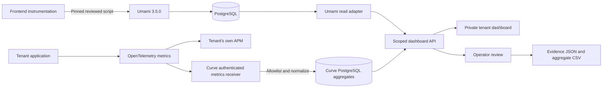

# Curve architecture and delivery boundaries

Curve is a reviewer evidence layer for the SCF shared analytics service. Its local prototype demonstrates the reporting workflow and an actual metrics ingestion path. It is not yet the completed hosted RFP service.

## Running implementation

React and TypeScript dashboard; Express API; PGlite (embedded PostgreSQL) local durable storage. Umami remains the web collection foundation. The local demonstration fixtures are separate from live Umami reporting. New project API metrics are accepted through a restricted OTLP/HTTP JSON receiver. This limited protocol surface must not be advertised as a complete OTel collector replacement.

The project deliberately does not add blockchain transactions merely to qualify as a Stellar project. It serves Stellar teams; metrics do not require consensus or public immutable personal data. Infrastructure is centralized for operation and access control, with open-source reproducibility and a planned stewardship transfer.

## Proposed differentiators

1. Reproducible reviewer evidence: versioned metric definitions, explicit reporting window, source status and integrity digest. A digest checks edits, not traffic authenticity or external attestation.
2. Explainable reliability: show absent sources, incomplete coverage and suspicious traffic separately. Do not silently convert missing values into healthy zeroes.
3. Privacy minimization at ingestion: accept only specified metric fields; normalize dynamic routes; discard traces/logs and unsupported attributes. This is engineering evidence, not a legal compliance conclusion.
4. Handover rehearsal: an independent operator must restore the service and demonstrate tenant isolation before acceptance.

## Production gates

- Replace local role-switch authentication with verified identities, secure sessions, MFA for operators and invitation/recovery controls. Configure scoped Umami website mappings server-side.
- Deploy managed PostgreSQL with migration testing, backup restoration, capacity limits and tenant isolation defense in depth. PGlite local mode is not the proposed million-request/day hosting architecture.
- Add production gateway authentication, quotas, retry/idempotency behavior, distributed rate limiting and audit logs. Validate protobuf OTLP, cumulative temporality, histogram conventions and aggregation semantics against actual SDKs.
- Implement frontend provenance and bot controls without treating Origin headers or JavaScript execution as proof of humanity. Assess shared-IP fingerprint skepticism, privacy retention and accessibility impacts.
- Review and pin dependency artifacts by immutable digest and enforce release approval, SBOM, integrity checks and intentional tenant upgrades.
- Validate 24-month aggregate retention and deletion/erasure behavior; do not retain IPs, full URLs, wallet addresses or arbitrary dimensions in reports.
- Load test at the RFP target, including bursts. Measure ingestion and dashboard availability separately before making SLA commitments.
- Obtain real pilot adoption, privacy review, operational ownership and eligibility confirmation.
